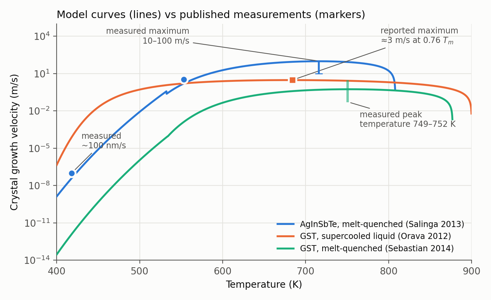

# pqcsim

A physics simulator for optical phase-change devices, from a single laser pulse to a whole chip.

Phase-change materials such as GST (germanium–antimony–tellurium, the material of rewritable DVDs) switch
between a glassy and a crystalline form when heated by a laser. The two forms reflect and absorb light
differently, so they can store data or set weights in optical computing. `pqcsim` follows the full chain:

```
laser light  ->  absorption in thin films  ->  heat flow  ->  melting / crystal growth  ->  readout
     ->  arrays of pixels (write disturb between neighbours)  ->  optical circuits (classical and quantum)
```

Every model is checked: against closed-form solutions and independent calculations in `tests/`, against
established external codes, and against published measurements in [docs/validation.md](docs/validation.md),
including the comparisons that did **not** agree.



*How fast the crystal grows at each temperature, for three materials, over 16 orders of magnitude. Lines are
the model with each paper's own parameters (no fitting); markers are the values the papers measured. The
step near 530 K is where the melt-quenched glass joins the supercooled liquid. Made by
`examples/plot_crystal_growth.py`.*

## Highlights

- **Numerical methods in Python/NumPy/SciPy**: thin-film transfer matrices, rigorous coupled-wave analysis
  (RCWA) for periodic pixel arrays and focused beams, axisymmetric and 3D finite-volume heat solvers with
  phase change, crystal-growth and nucleation kinetics, Monte Carlo and Sobol sensitivity analysis.
- **Performance-aware**: sparse direct solvers with cached factorisations and bounded memory, reusable
  linear heat responses so parameter sweeps do not re-solve the heat equation, convergence studies for every
  discretisation parameter.
- **C++ core with Python bindings** (pybind11): an exact multi-photon (Fock-basis) quantum engine.
- **Tested**: about 270 pytest tests, run by GitHub Actions on Python 3.10–3.12, with benchmarks against
  `tmm`, The Walrus, Perceval, FiPy and grcwa.
- **Documented**: every equation, approximation and its test in [docs/physics.md](docs/physics.md).

## Quick start

```bash
git clone --recurse-submodules https://github.com/krabidi/pqcsim.git
cd pqcsim
pip install ".[test]"                              # builds the C++ engine and installs pqcsim
cmake -S . -B build -DCMAKE_BUILD_TYPE=Release && cmake --build build -j   # for the in-repo tests
python3 -m pytest tests
```

Needs Python 3.8+, a C++17 compiler and CMake 3.14+. If you cloned without `--recurse-submodules`, run
`git submodule update --init` first. `pip install ".[bench]"` adds the external reference codes for the
benchmark tests (they are skipped when missing).

## Examples

```bash
python3 examples/pcm_device_to_circuit.py      # device -> array -> classical/quantum circuit
python3 examples/thermal_crosstalk.py          # simple vs diffusion heating, neighbour disturb vs pixel pitch
python3 examples/hong_ou_mandel.py             # two-photon interference with the C++ engine
python3 examples/plot_crystal_growth.py        # the figure above (needs matplotlib)
python3 -c "from pqcsim.io.circuit_file import load_circuit; print(load_circuit('examples/circuits/hom_pcm.yaml').run())"
```

## What is inside

| Level | Module | What it does |
|---|---|---|
| Materials | `materials` | optical constants, effective-medium mixing, thermal and kinetic data |
| Optics | `optics.tmm`, `optics.rcwa`, `optics.focused` | thin-film optics; periodic pixel arrays; focused Gaussian beams |
| Device | `devices` | optically programmed PCM cell; crystal growth; nucleation (classical nucleation theory) |
| Heat | `thermal` | axisymmetric and 3D voxel heat solvers, phase change, reusable pulse responses |
| Array | `arrays` | PCM pixel arrays: write disturb between neighbours, optical matrix-vector products |
| Circuit | `circuits` | lossy linear networks, couplers, rings, PCM segments, S-parameters |
| Quantum | `quantum` | Fock states with loss and partial distinguishability, Gaussian sources, detectors |
| Electronics | `electronics` | photodetector and amplifier noise, ADC, heaters, crosstalk compensation |
| Analysis | `analysis` | fabrication Monte Carlo and yield, calibration fits, uncertainty and sensitivity |

## Validation

| Check | Result |
|---|---|
| Thin-film optics vs `tmm` | agreement ≤ 1e-12 |
| Heat conduction vs FiPy (NIST) | < 1 % of peak at all times |
| Pixel-array optics vs grcwa | ≤ 1e-3 |
| Multi-photon probabilities vs The Walrus, Perceval | ≤ 1e-10 |
| Crystal growth (Salinga 2013, Orava 2012) | published values reproduced |
| GST-on-silicon waveguide loss (Zheng 2018) | measurement reproduced within its error |
| Thermal transient of a GST memory cell (Ríos 2015) | reproduced within ±2 K |
| Femtosecond switching thresholds (Schlich 2015) | relative thresholds reproduced |

Full list, with the cases that failed and why: [docs/validation.md](docs/validation.md). The scripts that
reproduce each comparison are in `validation/`.

## Quantum engine (C++)

`FockState` holds a superposition over photon-number states of several optical modes, and `OpticalCircuit`
applies beamsplitters and phase shifters to it as exact unitaries. Beamsplitter convention, with `U[out][in]`:

```
U = [[cos θ,              i e^{-iφ} sin θ],
     [i e^{iφ} sin θ,     cos θ          ]]      θ = π/4 → 50:50
```

Hong–Ou–Mandel interference:

```python
import photonics_core as pc

out = pc.OpticalCircuit(2).beamsplitter(0, 1).run(pc.FockState([1, 1]))
print(out.probabilities())       # {(0, 2): 0.5, (2, 0): 0.5}  -- no (1, 1) coincidences
```

Other methods: `amplitude(occ)`, `probability(occ)`, `mean_photon_number(mode)`, `norm()`,
`sample(shots, seed)`, and `phase_shift(mode, phi)` on circuits. The tests check every output amplitude
against an independent matrix-permanent calculation.

## Project layout

```
pqcsim/                   Python package (see "What is inside")
core/, bindings/          C++ quantum engine and its pybind11 bindings
tests/                    pytest suite (unit tests, convergence checks, external benchmarks)
validation/               scripts comparing the model with published experiments
docs/physics.md           equations, approximations and how each is tested
docs/validation.md        comparisons with measurements, including the failures
data/                     material data with literature sources; data/nk: measured n, k (refractiveindex.info, CC0)
examples/                 runnable demo scripts
```

## License

GPL-3.0, see [LICENSE](LICENSE).
